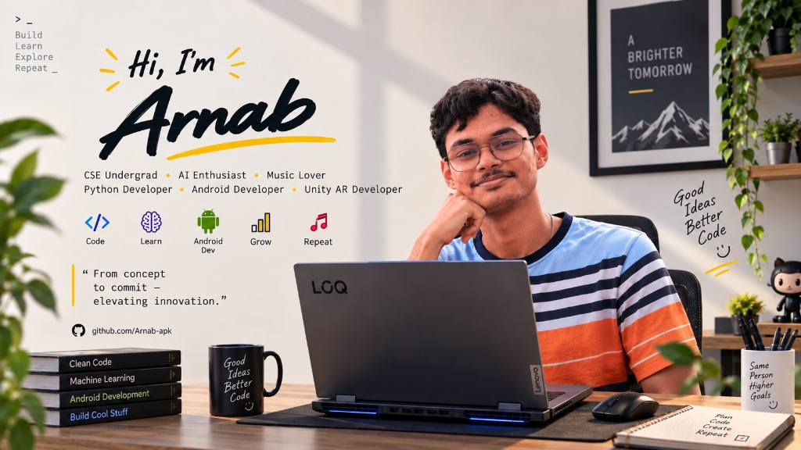

<!-- ============================================================
     ARNAB MANDAL — PREMIUM GITHUB PROFILE README
     Terminal-style: ASCII Portrait + Neofetch Card + Live Heatmap
     Designed with ❤️ for developers who appreciate craft
     ============================================================ -->

<div align="center">

<!-- Premium Banner with subtle animation -->


<br/><br/>

<!-- Premium Social Links with hover effects -->
[](https://www.linkedin.com/in/arnab-mandal-00200131a/)
[](mailto:arnabmandal.dev@gmail.com)
[](https://github.com/Arnab-apk)
[](https://instagram.com/_mr.invictus__)
[](https://leetcode.com/u/6IDfCDzl1s/)
[](https://twitter.com/_mr.invictus__)

<br/><br/>

<!-- Premium Tagline -->


<br/><br/>

<!-- Profile Views with premium styling -->
[](https://github.com/Arnab-apk)

</div>

---

<!-- ============================================================
     LIVE CONTRIBUTION HEATMAP — Premium Animated Calendar
     ============================================================ -->
<div align="center">

<h3><code>arnab@github ~ $ contributions --graph --premium --live</code></h3>



<br/><br/>

</div>

<!-- ============================================================
     PREMIUM TERMINAL LAYOUT — ASCII Portrait + Info Card
     ============================================================ -->
<div align="center">

<h3><code>arnab@github ~ $ whoami --premium</code></h3>

<table>
  <tr>
    <td valign="top" width="48%" style="padding-right: 12px;">
      
    </td>
    <td valign="top" width="52%" style="padding-left: 12px;">
      
    </td>
  </tr>
</table>

<br/>

</div>

---

<!-- ============================================================
     ABOUT ME — Premium Storytelling Section
     ============================================================ -->
<div align="center">

## 🧑‍💻 About Me

</div>

> **"Code. Break. Fix. Ship. Repeat."**

<div align="center">

| | | |
|:---:|:---:|:---:|
| 🧠 **AI Engineer** | 💻 **Full Stack Developer** | 📱 **Mobile & AR Developer** |
| Building production-grade GenAI systems | Next.js • React • TypeScript • Go | Flutter • Kotlin • Unity AR |

</div>

I'm a **Full Stack Developer**, **AI Engineer**, and relentless builder with a deep focus on **Generative AI**, **Agentic AI systems**, and **production-grade LLM applications**. I don't just learn technologies — I build real things with them, from RAG pipelines to autonomous agents, from console games to full-stack platforms.

Currently pursuing **B.Tech in Computer Science & Engineering** at Academy of Technology (AOT), Kolkata.

```python
class Arnab:
    name        = "Arnab Mandal"
    alias       = "Mr.Invictus"
    role        = ["AI Engineer", "Full Stack Developer", "Android Dev", "Unity AR Dev"]
    languages   = ["Python", "TypeScript", "Go", "Kotlin", "Dart", "C++", "C", "SQL"]
    passion     = "Turning concepts into commits & elevating innovation"
    superpower  = "Build → Learn → Explore → Repeat"
    philosophy  = "Good Ideas, Better Code"
    fueled_by   = "Ideas & Coffee ☕"
    currently   = "Building Agentic AI workflows & RAG systems at scale"
    fun_fact    = "I've forked more AI repos than most people have bookmarked"
    motto       = "The best way to learn is to ship."
```

---

<!-- ============================================================
     FEATURED PROJECTS — Premium Showcase Cards
     ============================================================ -->
## 🚀 Featured Projects

<div align="center">

*Each project represents a unique challenge solved with modern tech stacks*

</div>

---

### 🌺 **Uma (Pujo Parikrama)** — *Real-Time Durga Puja Navigation & Live Group Hopping*

> **Flutter · Dart · Magic Lane Maps · OpenStreetMap · Firebase · Real-Time Group Sync**

A flagship high-performance Android mobile application built for navigating Kolkata's monumental Durga Puja festival. Curates **330+ verified pandals** with offline vector tile caching, turn-by-turn routing, voice navigation, and live crowd telemetry. Features real-time companion tracking with separation perimeter alerts, walkie-talkie audio, dynamic festival day-aware theme morphing, and resilient offline Google & Guest session management.

**Tech Stack:** `Flutter 3` `Dart` `Magic Lane GemKit SDK` `OpenStreetMap` `Firebase Auth & Firestore` `WebSockets` `SQLite / Vector Tile Caching` `Geolocator` `Provider`

[](https://flutter.dev)
[](https://dart.dev)
[](https://firebase.google.com)
[](https://android.com)

---

### 🎵 **Roomi** — *Real-Time Shared Music Platform*

> **Next.js 15 · React 19 · TypeScript · Socket.io · Spotify API · YouTube Music**

A real-time shared music platform that democratizes the aux at parties and group hangouts. Create rooms, share 6-character codes, and let everyone collaboratively build a queue with **democratic voting** to decide what plays next. Guests join instantly — no account needed. Features animated vinyl themes, glassmorphic UI, and seamless Spotify/YouTube Music integration.

**Tech Stack:** `Next.js 15` `React 19` `TypeScript` `Express` `Socket.io` `Spotify OAuth` `Tailwind CSS` `Framer Motion`

[](https://nextjs.org)
[](https://react.dev)
[](https://typescriptlang.org)
[](https://socket.io)

---

### 🐉 **Chimera-CLI** — *AI-Powered Docker Config Generator*

> **Go · Cobra · Bubble Tea · Multi-LLM · Docker**

A developer CLI tool that **autonomously analyzes GitHub repos and generates production-ready Docker configurations**. Point it at any repo — it clones, detects frameworks (Express, Next.js, React, FastAPI, Flask, Django), validates findings via LLM, and spits out optimized multi-stage Dockerfiles + docker-compose configs. Supports OpenAI, Anthropic, Groq, Gemini, and Ollama as LLM providers.

**Tech Stack:** `Go` `Cobra CLI` `Bubble Tea TUI` `Lipgloss` `Docker` `Multi-LLM (OpenAI, Anthropic, Groq, Gemini, Ollama)`

[](https://golang.org)
[](https://docker.com)
[]()

---

### 👨‍💻 **Code_CollabV2** — *Real-Time Collaborative Code Editor*

> **React 19 · Monaco Editor · Yjs CRDTs · FastAPI · WebSockets**

A browser-based collaborative coding platform where multiple developers **write, edit, and review code together in real time**. Powered by **Yjs CRDTs** for conflict-free concurrent editing with millisecond sync — no central authority needed. Features live remote cursors, Monaco Editor (VS Code engine), room management with approval workflows, real-time chat, and GitHub OAuth for repo imports.

**Tech Stack:** `React 19` `TypeScript` `Monaco Editor` `Yjs` `FastAPI` `WebSockets` `Tailwind CSS`

[](https://react.dev)
[](https://fastapi.tiangolo.com)
[]()

---

### 🧠 **Model-StudyPlace** — *Interactive 3D Educational Platform*

> **Google Model Viewer · Vanilla JS · Tailwind CSS · Gemini AI**

A modern, interactive **3D learning hub** built with zero build steps — pure Vanilla JS, Tailwind CSS, and Google Model Viewer. Explore 3D models in the browser with full mobile responsiveness, and chat with an integrated **AI tutor powered by Google Gemini**. Deployed on Vercel with serverless API proxying for secure key management.

**Tech Stack:** `HTML` `JavaScript` `Tailwind CSS` `Google Model Viewer` `Gemini API` `Vercel Serverless`

[](https://developer.mozilla.org/en-US/docs/Web/HTML)
[](https://developer.mozilla.org/en-US/docs/Web/JavaScript)
[](https://tailwindcss.com)
[](https://ai.google.dev)

---

### 🔐 **CredVault (hackstorm)** — *Decentralized Identity MVP*

> **Next.js · Solidity · MongoDB · Merkle Proofs · Ed25519**

A decentralized identity system for issuing, storing, sharing, and verifying credentials on-chain. Uses **Merkle proofs** for credential integrity and anchors batch roots via Solidity smart contracts on Polygon Amoy. Features role-based dashboards (issuer/recipient/verifier), wallet-based auth, selective disclosure through shareable links, and five predefined credential schemas.

**Tech Stack:** `Next.js` `React` `TypeScript` `MongoDB` `Solidity` `Hardhat` `Ed25519` `Keccak Hashing` `Polygon`

[](https://soliditylang.org)
[](https://nextjs.org)
[](https://polygon.technology)

---

<!-- ============================================================
     TECH STACK — Premium Visual Skills Matrix
     ============================================================ -->
## 🛠️ Tech Stack

<div align="center">

### 🧠 AI & Machine Learning

<br/><br/>


<br/><br/>

### 🌐 Full Stack & Web

<br/><br/>


<br/><br/>

### 📱 Mobile, AR & Languages

<br/><br/>


<br/><br/>

### 📡 Databases & Vector Storage

<br/><br/>


<br/><br/>

### 🔧 Tools & DevOps

<br/><br/>


</div>

---

<!-- ============================================================
     GITHUB STATS — Premium Dashboard
     ============================================================ -->
## 📊 GitHub Analytics

<div align="center">

### Contribution Overview


<br/>


<br/>


</div>

---

<!-- ============================================================
     PACMAN CONTRIBUTION GRAPH (Classic)
     ============================================================ -->
## 👻 Eating Up My Contributions

<div align="center">
	<picture>
		<source media="(prefers-color-scheme: dark)" srcset="https://raw.githubusercontent.com/Arnab-apk/Arnab-apk/output/pacman-contribution-graph-dark.svg">
		<source media="(prefers-color-scheme: light)" srcset="https://raw.githubusercontent.com/Arnab-apk/Arnab-apk/output/pacman-contribution-graph.svg">
		
	</picture>
</div>

---

<!-- ============================================================
     DEVELOPMENT ROADMAP — Premium Goals Tracker
     ============================================================ -->
## 🎯 Development Roadmap

<div align="center">

| Phase | Goal | Status | Progress |
|:---:|:---|:---:|:---:|
| 🤖 | Master **LangGraph** & advanced agentic workflows | `IN PROGRESS` | ████████░░ 80% |
| 🔬 | Ship **10+ AI-powered** production applications | `IN PROGRESS` | ███████░░░ 70% |
| 🌐 | Full Stack + **GenAI convergence** at scale | `IN PROGRESS` | ██████░░░░ 60% |
| 📡 | Production-grade **RAG pipelines** with vector DBs | `IN PROGRESS` | ██████░░░░ 60% |
| 💪 | Strengthen **DSA** with C++ & competitive coding | `GRINDING` | ████░░░░░░ 40% |
| 🚀 | Contribute to **major open-source** AI projects | `EXPLORING` | ███░░░░░░░ 30% |
| ☁️ | **Kubernetes** & cloud-native AI deployment | `NEXT UP` | ██░░░░░░░░ 20% |
| 🏗️ | Build & deploy a **production AI SaaS** app | `PLANNED` | ░░░░░░░░░░ 0% |

</div>

---

<!-- ============================================================
     COMPETITIVE CODING
     ============================================================ -->
## 🧭 Competitive Coding

<div align="center">

[](https://leetcode.com/u/6IDfCDzl1s/)
[](https://www.hackerrank.com/profile/arnabmandal261)

</div>

---

<!-- ============================================================
     FOOTER — Premium Closing
     ============================================================ -->
<div align="center">

<br/>


<br/>

### *"The best way to learn is to ship."*<br/>**— Arnab Mandal**

<br/>

[](https://github.com/Arnab-apk)
[](https://github.com/Arnab-apk)

<br/><br/>

</div>

---

<!-- ============================================================
     TECHNICAL DETAILS — For Fellow Developers
     ============================================================ -->
<details>
<summary><b>⚙️ How this premium animated profile works</b></summary>
<br/>

This profile uses **pure animated SVGs** — no JavaScript, no external services, no tracking, no iframes.

### The Three Premium Components

| Component | File | Animation | Tech |
|-----------|------|-----------|------|
| **Contribution Heatmap** | `premium-heatmap.svg` | Diagonal wave reveal + stat count-up | CSS Keyframes + SMIL |
| **ASCII Portrait** | `premium-ascii.svg` | Scanline sweep + line-by-line fade + cursor blink | SMIL `<animate>` |
| **Info Card** | `premium-info-card.svg` | Staggered slide-in + progress bar growth + pulse icons | CSS Keyframes + SMIL |

### Technical Architecture

- **Zero JavaScript** — GitHub strips `<script>` tags; animations run natively via SMIL/CSS inside SVGs
- **Real Data** — Heatmap scrapes public contributions page via `fetch_contributions.py` (no PAT needed)
- **Auto-Refresh** — GitHub Actions cron (daily 06:17 UTC) fetches & re-renders heatmap automatically
- **Self-Contained** — Each SVG works standalone; README embeds via `` tags only
- **Premium Design System** — Cohesive color palette, typography, spacing, and animation curves

### Local Development

```bash
# Clone your username repo
gh repo clone Arnab-apk
cd Arnab-apk

# Set up Python environment
python -m venv .venv && source .venv/bin/activate
pip install -r scripts/requirements.txt

# Generate premium assets (animated versions for production)
python scripts/premium_ascii.py
python scripts/premium_info_card.py

# For heatmap (requires network):
python scripts/fetch_contributions.py Arnab-apk
python scripts/premium_heatmap.py

# Static previews for quick iteration:
STATIC=1 python scripts/premium_ascii.py
STATIC=1 python scripts/premium_info_card.py
STATIC=1 python scripts/premium_heatmap.py
```

### Design System

```css
/* Premium Color Palette */
--bg-deep:       #080c14;
--bg-card:       #0d131f;
--border:        #1e2a3a;
--accent-cyan:   #00d4ff;
--accent-green:  #00ff88;
--accent-gold:   #ffd700;
--accent-coral:  #ff6b6b;
--accent-purple: #c084fc;
--accent-orange: #fb923c;
--text-primary:  #f0f4f9;
--text-secondary:#a0b0c0;
--text-muted:    #5a6a7a;

/* Animation Curves */
--ease-out:      cubic-bezier(0.16, 1, 0.3, 1);
--ease-spring:   cubic-bezier(0.175, 0.885, 0.32, 1.275);
```

### Inspiration & Credits

- **Core Concept**: [Avi Vashishta's blog](https://www.avivashishta.com/blog/build-animated-github-profile-readme) — "How I Built an Animated GitHub Profile README"
- **Design Inspiration**: Terminal aesthetics, neofetch, GitHub's contribution graph
- **Animation Techniques**: SMIL animations, CSS keyframes, staggered reveals
- **Icons**: [Skill Icons](https://skillicons.dev), [Shields.io](https://shields.io)
- **Typography**: System UI monospace fonts (ui-monospace, SFMono-Regular, Menlo, Consolas)

</details>

---

<div align="center">

<sub>Built with precision • Animated with passion • Shipped with pride</sub><br/>
<sub>Last updated: <code id="last-updated"></code></sub>

<script>
  // This won't run on GitHub, but shows the intent
  document.getElementById('last-updated').textContent = new Date().toISOString().split('T')[0];
</script>

</div>